# MEOK: NVIDIA, Cosmos and the open-world learning loop
8 November 2026 · Codex · engineering research and review candidate · autoMerge:false

## Decision
Keep MEOK as the persistent, provider-independent human interaction and control layer. Use NVIDIA components behind that interface where they improve a measured task. Cosmos should supply hypothetical world rollouts; real desktop/game/sensor observations must remain the source of outcomes. The existing Dream/Evolve and Layer 0 contracts remain in charge of review and promotion.

The immediate implemented change adds NVIDIA's hosted chat API to the existing optional extension connection and shared MEOK/Council client. It does not deploy Cosmos, train weights, introduce a second memory store or give a model computer-control authority.

## Existing work recovered first
This builds on the 2–3 November Sovereign consolidation and research-nemo-20261102 review, rather than starting a competing architecture. Those notes are historical evidence, not current runtime qualification.

- The existing Council/MEOK selector candidates already separate local Ollama, offline AI, chosen cloud providers and public deterministic tools. Their baseline revisions are Council PR4008 a800e1e79799613ca50182289aee266a9f440c80 and MEOK PR13 2bbd71f48ee86560a6993a7ca702616dd9a67858. Both were still open and unmerged at this read.
- The retained ras_hive_os source implements sixteen counterfactual branches, frozen-simulation calibration, 3 KiB reaction cards and Evolve proposals. Its promotion decision remains HOLD even when the caller asserts improvement and authorization. Calibration binds observations for review and keeps training eligibility false.
- The existing meok-sovspace-sims-evolve-dream-loop runner calls that Python substrate and the existing HIM cycle route. It also contains remote inference and signing paths, so it was inspected and was not executed during this research.
- Existing TTT/fusion/routing notes are not proof of online base-model training. Keep episodic memory, adaptive router weights, architectural TTT layers, offline fine-tuning and benchmark evidence as distinct mechanisms.
- The archived alignment facts/capability files named by the MEOK skill were absent. No missing ledger was treated as loaded.
- Keep existing custody, Source publisher, protected release, charter and measurement boundaries. This research grants none of those authorities to an upstream framework.

Exact hashes of the recovered reaction_sim.py, evolve.py, three_kb.py and learning.py are in the companion source register. Existing model-performance figures were not copied into new product claims.

## What changed in the current upstream landscape
The relevant new work is Cosmos 3 and its current Framework, including action-conditioned forward dynamics, interactive simulation recipes and multiple modalities. Earlier Predict/Transfer/Reason release names are useful historical references but are insufficient for selecting today's integration.

NVIDIA's November technical article describes the current model-development and simulation workflows. Read the specific checkpoint's recipe; an automotive, surgical or bimanual action representation is not a generic desktop action vocabulary. [NVIDIA technical article](https://developer.nvidia.com/blog/build-world-models-for-interactive-simulation-with-nvidia-cosmos/)

A particularly important limitation appears in the official integration demos: their main transformer uses random weights and some conditioning is random. Passing those examples proves interface shapes and call sequence, not meaningful prediction or a working trained world model. [Integration demos](https://nvidia.github.io/cosmos-framework/examples/integration/)

The current NeMo Agent Toolkit documentation also marks that toolkit deprecated from October 2026 and end-of-life by year end. This changes the earlier November hunt's adoption advice: reuse interfaces, but avoid a new dependency on the retiring toolkit. [Lifecycle notice](https://docs.nvidia.com/nemo/agent-toolkit/latest/resources/migration-guide.html)

## Fit assessment
The decisions below are engineering recommendations for MEOK, not independently reproduced quality rankings. Repository code licensing, model weights, container rights and bundled dependencies must each be checked at the selected revision.

| Component | Concrete MEOK role | Decision and qualification |
|---|---|---|
| NVIDIA hosted NIM chat API | Optional reasoning provider inside the current selector | Implemented in this candidate. Fixed origin, explicit model/account, no fallback, offline lock preserved. It is not Cosmos video serving. [API](https://docs.api.nvidia.com/nim/reference/llm-apis) |
| Nemotron small/quantized models | Locally owned reasoning/router candidates through the existing runtime | Benchmark against the installed baseline before substitution. Weight-file size does not establish peak runtime memory. Quantized artifacts and architecture support require separate verification. [Nemotron models](https://huggingface.co/nvidia/NVIDIA-Nemotron-3.5-Bolt-E4B-4GB) |
| Cosmos3-Edge | First candidate for a bounded single-GPU visual prediction trial | Conditional. The model card lists Linux and NVIDIA hardware; its current tested precision is BF16. The Framework says this checkpoint has no audio tokenizer. Do not advertise Mac support or voice from a generic Diffusers snippet. [Card](https://huggingface.co/nvidia/Cosmos3-Edge), [inference](https://nvidia.github.io/cosmos-framework/inference/) |
| Cosmos3-Nano and Super | Higher-capacity offline generation, teacher or prediction comparison | Conditional GPU workers. Exact model, component and recipe determine memory. Published pages differ in headline parameter counts; record config and actual peak memory instead of selecting capacity from the family name. [Nano card](https://huggingface.co/nvidia/Cosmos3-Nano) |
| Cosmos simulation checkpoints | Controlled visual variations and action-conditioned hypothetical futures | Match the domain. Sim-Auto is multi-camera/LiDAR; Sim-Bimanual has specific embodiments; Sim-Transfer takes simulator control videos. Their release does not give MEOK general desktop dynamics. [Model reference](https://github.com/NVIDIA/cosmos/blob/main/docs/reference/models.md) |
| Cosmos Curator / Evaluator | Curate video data and evaluate generated output | Later, once owned recordings have rights, episode IDs and real outcome labels. Video quality and physical-task success are separate metrics. [Curator](https://github.com/NVIDIA/cosmos-curator), [Evaluator](https://github.com/NVIDIA/cosmos-evaluator) |
| PersonaPlex | Interruptible full-duplex human interaction trial | High-priority voice comparison, not a replacement memory system. Its prompt remains pinned while ordinary conversational context slides. Code is MIT; model weights use NVIDIA model terms and gated access. [Code](https://github.com/NVIDIA/personaplex), [card](https://huggingface.co/nvidia/personaplex-7b-v1) |
| NeMo Speech: streaming ASR, transcription, TTS | Preserve interchangeable voice input/output around the same MEOK session | Compare turn-taking, interruption and recognition with the existing voice path. VoiceChat is identified as Early Access; that is not the same release status as publicly downloadable PersonaPlex. [Speech](https://github.com/NVIDIA-NeMo/Speech) |
| Audio2Face-3D | Drive the visible professional avatar from the actual spoken audio | Useful avatar worker. The SDK requires Windows/Linux and CUDA/TensorRT; it is not a browser or Mac-native renderer. Keep rendering/animation distinct from reasoning and tool completion. [SDK](https://github.com/NVIDIA/Audio2Face-3D-SDK) |
| NeMo Agent Toolkit | Existing workflow compatibility and migration research | Do not add as a new core dependency: NVIDIA's latest documentation says deprecated October 2026, EOL by end 2026. Keep the existing MCP/A2A contracts and inspect its migration guidance before adopting a successor. The README's continuing feature list does not override the documentation lifecycle notice. [Migration guide](https://docs.nvidia.com/nemo/agent-toolkit/latest/resources/migration-guide.html) |
| OpenShell / NemoClaw | Isolated Linux agent environment and explicit resource/network policy | Evaluate beneath Layer 0 when a VM is qualified. OpenShell's enforcement is relevant; installing it does not itself prove the policy or grant production access. Do not replace the existing harness without a side-by-side trial. [OpenShell](https://github.com/NVIDIA/OpenShell), [NemoClaw](https://github.com/NVIDIA/NemoClaw) |
| NeMo Guardrails / Garak | Additional response-policy tests and adversarial probes | Reuse the existing charter/instrument banks. Language rails are advisory to the tool gate and are not proof that an action was authorized. [Guardrails](https://github.com/NVIDIA-NeMo/Guardrails), [Garak](https://github.com/NVIDIA/garak) |
| NeMo Gym | Episode harness, task verifier, replay and failure accounting | Strong fit for testing whether MEOK actually finishes work. Its environment catalogue already includes OpenEnv and OSWorld paths. Start with existing games/desktop tasks rather than inventing a new benchmark. [Gym](https://github.com/NVIDIA-NeMo/Gym) |
| NeMo RL / Automodel / Megatron | Offline adaptation and controlled post-training of owned candidates | Later training lane. Frozen held-out episodes, rights, tokenizer/architecture compatibility, reproducible seeds and rollback precede model promotion. [RL](https://github.com/NVIDIA-NeMo/RL) |
| NeMo Retriever, formerly NV-Ingest | Document extraction and retrieval | Reuse the existing KB/custody path. Do not fork user memory, move private documents to a new service or infer that ingestion verifies a source. [Retriever](https://github.com/NVIDIA/NeMo-Retriever) |
| Model Optimizer / TensorRT / Dynamo | Quantization and serving efficiency | Optional after a model wins a useful task and its current latency is measured. CUDA/precision/driver compatibility is recipe-specific. These are not learning mechanisms. [Model Optimizer](https://github.com/NVIDIA/Model-Optimizer), [Dynamo](https://github.com/ai-dynamo/dynamo) |
| Isaac Sim / Isaac Lab / GR00T | Robotics simulation, sensors, embodied policies | Defer for MEOK's first TV/desktop product. Useful if a specific robot task is later chosen; robotics releases do not directly solve browser control. [Isaac Sim](https://github.com/isaac-sim/IsaacSim), [GR00T](https://github.com/NVIDIA/Isaac-GR00T) |
| Omniverse / OpenUSD / ACE / Holoscan / Maxine | Presentation, interoperable scenes, media processing | Inspect only the part required by a chosen renderer or stream. The ecosystem includes mixed SDK, model and service terms; “all NVIDIA is open source” is not an accurate licensing description. No runtime from these families was installed here. |

## Non-NVIDIA alternatives that matter
| Alternative | Why compare it | Limit |
|---|---|---|
| Existing Luanti/OpenTTD and deterministic desktop/browser tools | Actual actions and outcome state; already owned and relevant to MEOK | A scripted actor or simulated score is not a trained agent. Preserve the existing acceptance boundaries. |
| DreamerV3 | Learns compact action-conditioned latent dynamics and an actor/critic from experience; closer to a game-learning objective than making attractive video | Needs environment-specific training and evaluation. It is not the same implementation as MEOK's RSI Dream. [Source](https://github.com/danijar/dreamerv3) |
| V-JEPA / RoboJEPA | Compare feature-space prediction with pixel generation when the goal is selecting actions | A pretrained video representation is not automatically an action controller. [V-JEPA](https://github.com/facebookresearch/vjepa2), [RoboJEPA](https://github.com/facebookresearch/robo_jepa) |
| HY-WorldPlay / HY-World-2.0 | Relevant to navigable, visually coherent worlds and action-conditioned rendering | Published pipelines can require substantial VRAM and multiple encoders, including separately gated artifacts. Validate the exact model stack and licence; do not equate a navigable scene with a verified simulator. [WorldPlay](https://github.com/Tencent-Hunyuan/HY-WorldPlay), [World 2.0](https://github.com/Tencent-Hunyuan/HY-World-2.0) |
| TTT-LM / TTT video | Architectural fast-weight state and long-sequence mechanisms | Not a plug-in that adds online learning to arbitrary black-box APIs. The video project's TTT-MLP kernel documents H100 training support. Keep existing routing adaptation and model training separate. [TTT-LM](https://github.com/test-time-training/ttt-lm-jax), [TTT video](https://github.com/test-time-training/ttt-video-dit) |
| OpenEnv / OSWorld / Agent-S / UI-TARS | Controlled game/desktop episodes and computer-use comparisons | Use actual tool outcomes, bounded sessions and cancellation. These do not inherit authority from model text. [OpenEnv](https://github.com/openenv/OpenEnv), [OSWorld](https://github.com/xlang-ai/OSWorld), [Agent-S](https://github.com/simular-ai/Agent-S), [UI-TARS](https://github.com/bytedance/UI-TARS) |

## Proposed unified loop
This is the integration design, not a claim that every worker below is running.

```mermaid
flowchart LR
    U[Person on TV, phone or computer] --> HIM[MEOK voice, avatar and session]
    HIM --> P[Goal, memory and current state]
    P --> D[Existing Dream: candidate branches]
    D --> W[Optional Cosmos or latent-world prediction]
    W --> C[Care charter, constraints and critic]
    C --> S[Suggestion or authorized task]
    S --> G[Existing Layer 0 tool gate]
    G --> E[Actual desktop or game environment]
    E --> O[Real outcome and provenance]
    O --> P
    O --> R[Calibration and held-out evaluation]
    R --> A[Evolve or adaptive-router proposal]
    A --> H[Existing review and release authority]
    H --> P
```

Separate three clocks:
1. Interaction: listen, interrupt, speak, animate and show actual work state. A slow video generator must not stall ordinary conversation.
2. Anticipation: run a bounded candidate comparison asynchronously; surface uncertainty, disagreements and a concrete next step.
3. Improvement: accumulate consented, source-bound episodes; propose and evaluate an update off the live path. Do not rewrite production weights or the charter because a model suggested it.

For the 3 KiB card, retain compact IDs, hashes, assumptions and provenance references. Store media separately under its existing custody policy. A generated future, an actual observed outcome and an approved tool action must never share the same evidence class.

## First comparison worth funding or provisioning
Use one existing MEOK task: prepare a small document or play a bounded existing game episode. Freeze the starting state and run:
A. Existing system.
B. Same system plus a proposed planning change.
C. Same system plus a Cosmos/latent-world forecast, only if its action/observation representation matches.
D. Same system plus the owned adaptive-routing/TTT candidate.

Hold the task set, base model where applicable, tool permissions, prompts, budget, evaluator and initial state fixed. Keep training/evaluation episodes separate. Track completion from environment state, invalid actions, correction/undo count, escalation quality, forecast calibration, p50/p95 latency, peak memory and cost/compute use. Preserve failures and publish null improvement. Model-judged fluency is not the primary success criterion.

For voice, add explicit interruption/late-audio checks and whether the same session resumes correctly after reconnect. For avatar, check audio/animation synchronization and whether the displayed “working/done” state matches actual task events.

## Runtime and offline preflight
No GPU model or new service was launched. The RunPod workspace device was offline at inventory time; the available Oracle/M4 hosts were below the existing disk floor, and the M2 fell below that floor during the scan. No cleanup, model download, migration or service restart was attempted.

Before a Cosmos trial, identify an already authorized host, exact checkpoint revision, component/encoder/tokenizer files, model licence acceptance, supported CUDA/driver/precision, peak-memory budget and bounded episode/GPU-time limit. The official offline path can still fetch missing vision towers or guardrail models. Pre-stage and verify required assets rather than disabling the care/tool boundary or assuming “weights are local” means offline.

The current catalogue read from NVIDIA returned 84 IDs, including cosmos-reason2-8b, on this pass. This is discovery, not inference or a claim that every ID supports chat. No external NVIDIA inference credential was read or used.

## Evidence and limits
SOURCE_PINS_20261108.json records 34 attempted public-repository reads, with 23 revision-pinned READMEs. Some unresolved rows reflect response-size bounds or public API rate limits, and one initial TTT repository name was corrected through its official repository. Separate primary web reads verified the relevant documentation and model cards. A metadata hit is not a reproduced model result, and this is a broad relevant-stack review rather than an exhaustive census of every NVIDIA repository.

Code/licence metadata marked NOASSERTION/other is deliberately unresolved; do not replace it with a blanket commercial-use assertion. Cosmos3 model cards identify OpenMDW1.1, whereas PersonaPlex identifies NVIDIA model terms plus gated access. Package/source licences do not settle all model, dataset or container rights.

The implemented NVIDIA provider reuses the same selection validation, trusted session-key handling and offline guard as the other providers. Twelve existing/new protocol test bodies pass in an in-memory Node harness; canonical CI remains the release gate. Generated bundles and extension package must be regenerated together, and MEOK's asset pin must match the same public source revision. No merge, deployment, training improvement, live Cosmos capability or GSPC measurement is claimed by this document.
